<div align="center">

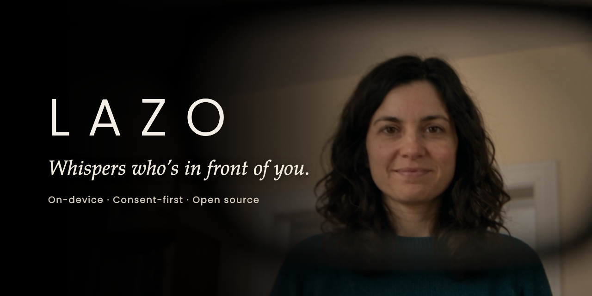

# Lazo

**Consent-first, on-device face recognition that whispers to a person with dementia who is in front of them; built for smart glasses, it works with any camera.**

[](https://github.com/nievesjesus/lazo/actions/workflows/ci.yml)
[](LICENSE)


[What it does](#what-it-does) · [How it works](#how-it-works) · [Screenshots](#screenshots) · [Results](#results) · [Quick start](#quick-start) · [Responsible use](#responsible-use) · [Known limitations](#known-limitations)

<a href="https://github.com/nievesjesus/lazo/releases/download/v0.1.0/lazo-trailer.mp4">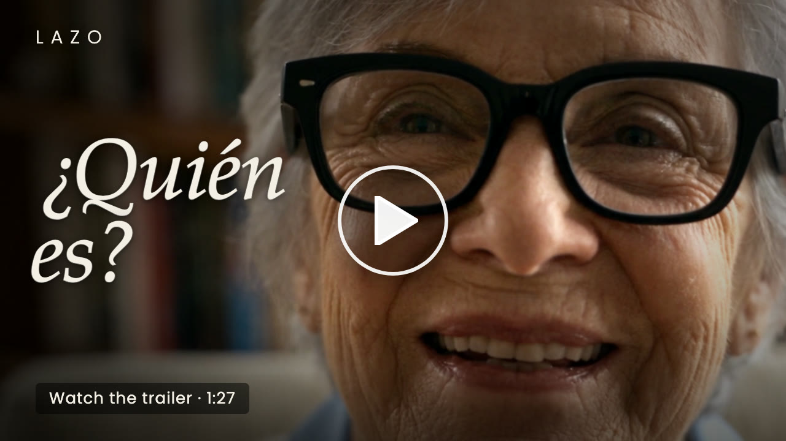</a>

<sub>Trailer (1:27, Spanish)</sub>

</div>

## What it does

- **Consent first.** Only people who enrolled in person are recognized; strangers are neither named nor stored.
- **Nothing leaves the device.** Frames, audio and templates stay local; the e2e test asserts no requests to other origins.
- **Silent when unsure.** A three-zone decision says «no estoy seguro» ("I'm not sure") rather than guess.

<p align="center">
  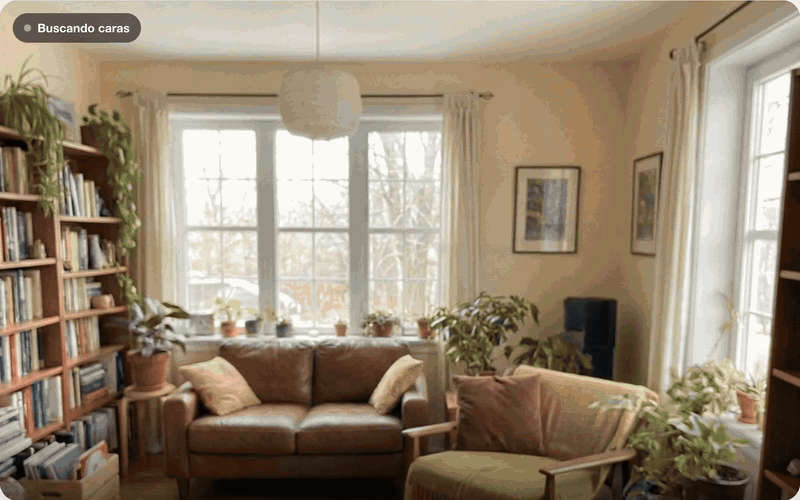
  <br>
  <sub>The web app recognizing Marta and whispering «Es Marta, tu hija» ("It's Marta, your daughter"). The face is AI-generated.</sub>
</p>

## How it works

Eight stages turn a camera frame into, at most, one whispered phrase per encounter. The same pipeline is implemented three times (Python, web and Android) with the same models and the same thresholds; see [Implementations](#implementations).

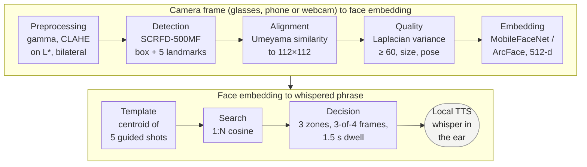

- Quality is measured on the aligned 112×112 crop, so it runs after detection and alignment; a frame that fails it is not used.
- Enrollment runs the same stages on 5 guided shots and stores their normalized centroid as the person's template. Recognition searches the closed, encrypted gallery of templates (up to 50 people). An image is never stored.

The decision stage compares the best match `s_max` with two thresholds and answers one of three ways:

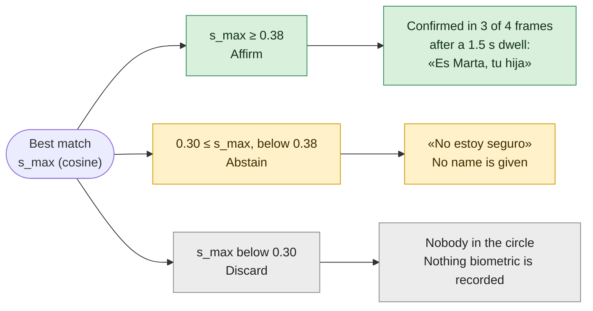

The thresholds shown are the defaults (τ_low = 0.30, τ_high = 0.38). The evaluation derives τ_high on a validation split for each gallery size (see [Results](#results)).

## Screenshots

The app's interface and spoken prompts are in Rioplatense Spanish, the language of its intended users; code, comments and docs are in English. All the faces shown are AI-generated.

<table>
  <tr>
    <td width="50%" align="center">
      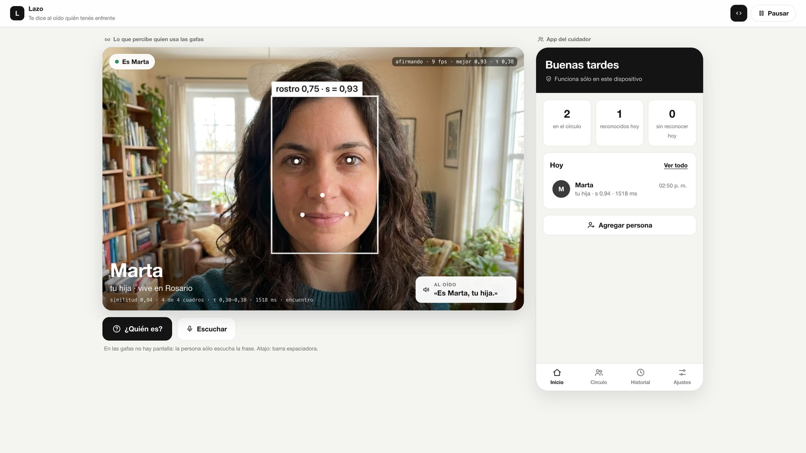
      <br><sub>Recognized: the wearer's view (left) and the caregiver app (right).</sub>
    </td>
    <td width="50%" align="center">
      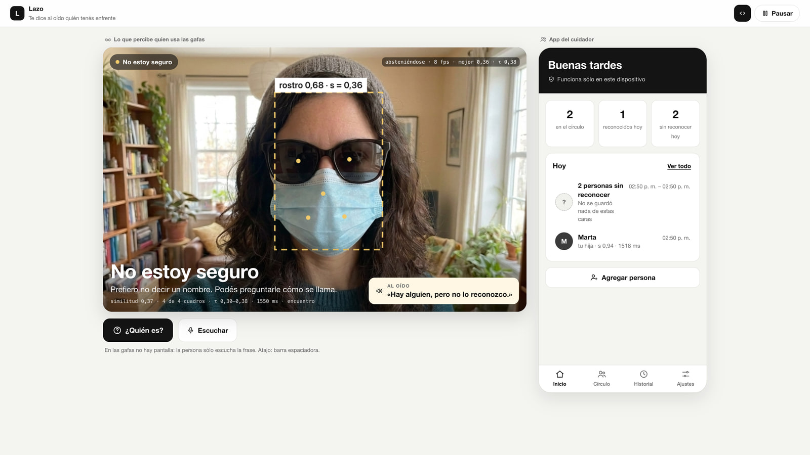
      <br><sub>Abstention: «Hay alguien, pero no lo reconozco» ("There's someone, but I don't recognize them"). Similarity 0.36 falls between 0.30 and 0.38, so no name is given.</sub>
    </td>
  </tr>
</table>

<table>
  <tr>
    <td width="33%" align="center">
      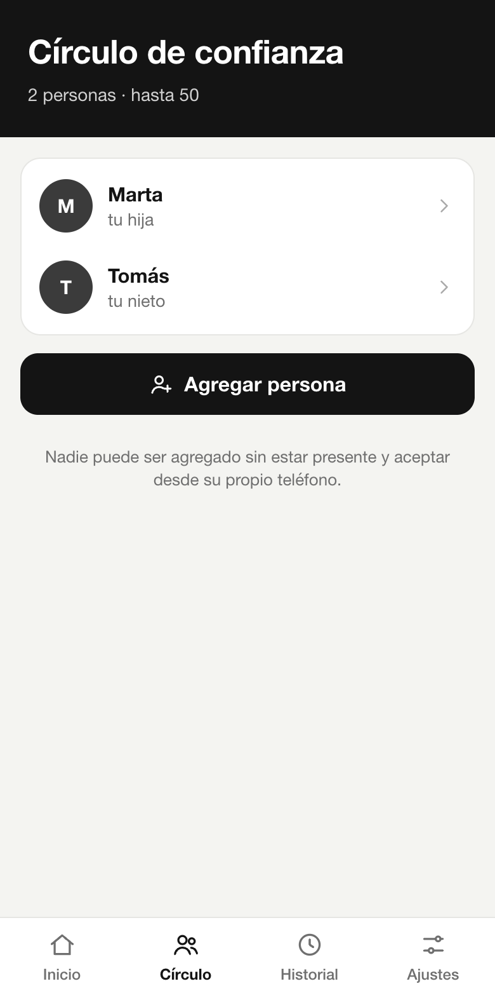
      <br><sub>Circle of trust. Nobody can be added without being present and accepting on their own phone.</sub>
    </td>
    <td width="33%" align="center">
      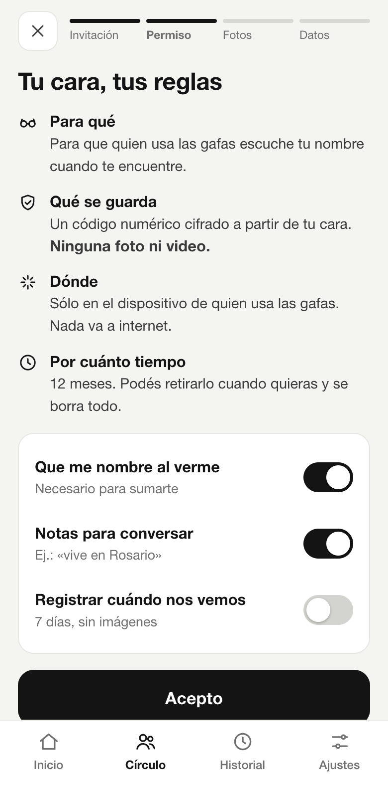
      <br><sub>Granular consent: what is stored, where, and for how long.</sub>
    </td>
    <td width="33%" align="center">
      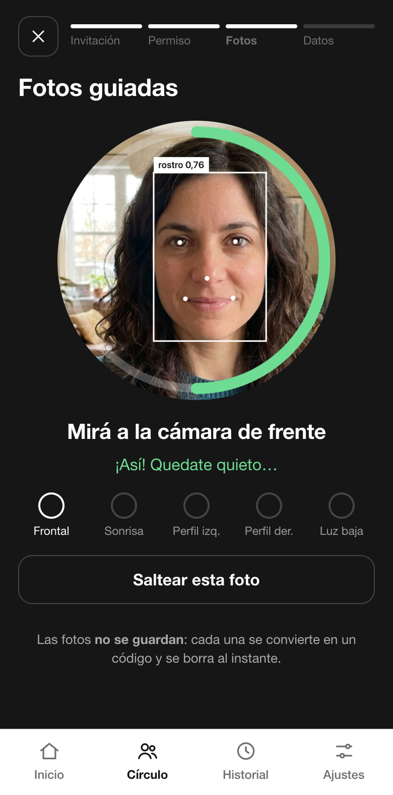
      <br><sub>Guided capture of 5 shots. Photos are not stored.</sub>
    </td>
  </tr>
</table>

## Results

The evaluation on LFW is in [`docs/eval/`](docs/eval): report, distributions, DET curve, error vs. threshold, ablation and latencies.

Main results on LFW (identity-level split, τ derived on validation for FPIR = 1% and frozen before testing):

| Gallery | τ_high | FPIR | FNIR | Rank-1 | Abstention |
|---|---|---|---|---|---|
| N = 10 | 0.269 | 0.89% | 2.63% | 97.4% | 13.1% |
| N = 25 | 0.354 | 0.09% | 3.37% | 96.6% | 1.8% |
| N = 50 | 0.384 | 0.11% | 2.87% | 97.7% | 0.7% |

<p align="center">
  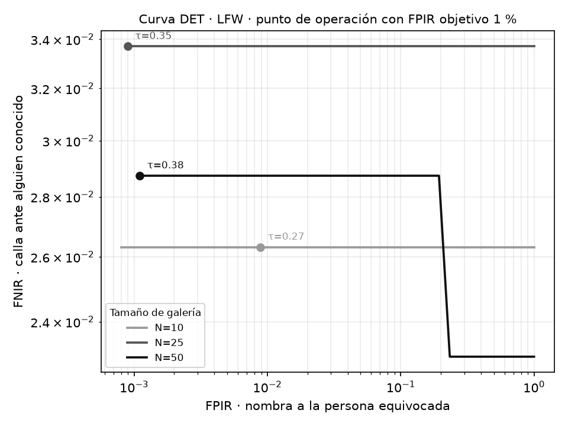
  <br>
  <sub>DET curve on LFW. The dots mark each operating point (τ_high, target FPIR 1%). More plots are in <a href="docs/eval"><code>docs/eval/</code></a>.</sub>
</p>

- **Ablation:** without alignment, FNIR at N = 50 rises from 2.9% to 14.9%. Without preprocessing there is no significant change on LFW (3.5%).
- **Rank-1 errors:** the 4 at N = 50 fall below τ_low; none would have named another person.
- **Latency per 1280×720 frame on an Apple M4:** 23 ms (p50) and 33 ms (p95) in Python; 49 ms and 54 ms in the browser with 4-thread WebAssembly. The announcement arrives at ≈ 1.5 s because of the minimum dwell time, which is deliberate.
- **Traffic:** the e2e test (`make e2e`) verifies that the app makes no requests to other origins.

All the people in `assets/faces/`, which the demos and the latency benchmarks use, are **AI-generated synthetic faces**. The photo in `core/tests/data/group.jpg` is InsightFace's sample image and is only used in tests.

## Quick start

Requirements: Node ≥ 20.19 (see `.nvmrc`), [uv](https://docs.astral.sh/uv/) and, for the e2e tests, Google Chrome. First install everything (Python environment, web dependencies and models):

```bash
make setup
```

Then start the demo:

```bash
make dev
```

It runs at http://localhost:5173.

| Task | What it does |
|---|---|
| `make` | Lists all tasks |
| `make doctor` | Checks tools and models |
| `make dev` / `make dev-phone` | Web demo locally / over HTTPS to open from your phone |
| `make live` | Python test bench with the webcam (`ARGS="--listen"` for voice) |
| `make enroll NAME=Marta REL="tu hija"` | Enrollment from Python. The relation is spoken back as «Es Marta, tu hija» ("It's Marta, your daughter") |
| `make test` · `make e2e` · `make check` | Unit tests · e2e with a fake camera and microphone · everything before a commit |
| `make eval` | FPIR/FNIR evaluation on LFW and plots in `docs/eval/` (threshold, DET and distributions) |
| `make android` | Opens the app in Android Studio |
| `make clean` / `make distclean` | Cleans builds / leaves the repo as freshly cloned |

Models: InsightFace's `buffalo_sc`, which includes SCRFD-500MF (detection + 5 landmarks) and MobileFaceNet/ArcFace (512-d embedding), about 16 MB. For voice listening in the web demo, quantized ONNX Whisper base is added, about 77 MB.

```bash
scripts/download_models.sh
```

## Implementations

Lazo is software, not hardware: an abstract capture interface connects it to the glasses, the phone camera or a webcam. The same eight-stage pipeline (preprocessing, quality, detection, alignment, *embedding*, template, search and decision) is implemented three times, with the same models and the same thresholds:

| Folder | What it is | Status |
|---|---|---|
| [`core/`](core) | Python test bench: reference pipeline, encrypted gallery, webcam CLI, FPIR/FNIR evaluation and DET curve | 26 tests pass, including end-to-end tests with the real models |
| [`web/`](web) | Web demo with a webcam or phone camera. Wearer view and caregiver app, all in the browser | 23 unit tests + 5 e2e assertions pass in headless Chrome. Parity with Python: cosine ≥ 0.995 per face |
| [`android/`](android) | Android app with the **abstract capture interface**: phone camera (CameraX), **Ray-Ban Meta** (Meta Wearables DAT 1.0) and simulated glasses (MockDeviceKit) | Written against the official sample's API; **not compiled yet** (see [Known limitations](#known-limitations)) |

> [!NOTE]
> Lazo is the project's public name. The Python package (`mnemo`, `mnemo-eval`) and the Android app keep the original name MNEMO.

## Web demo (webcam)

```bash
cd web
npm install
npm run dev          # http://localhost:5173
```

**On the phone.** The camera requires HTTPS, so run this on the same Wi-Fi network as the phone:

```bash
npm run dev:phone    # https://<your-mac-ip>:5173 (self-signed certificate: accept it once)
```

In *Privacidad → Cámara* ("Privacy → Camera") choose **Trasera** ("Rear"). With the phone held at eye level, it stands in for the glasses: this is the fallback plan while there is no access to the real glasses.

**What you can do:**
- *Invite someone to the circle*: follows the sequence invitation → granular consent → guided capture of 5 shots with sharpness and pose checks → profile.
- *Wearer view*: bounding box, 5 landmarks, similarity, 3-of-4 confirmation and the phrase whispered in the ear by the system's local voice.
- *Person change*: if another face replaces the one already announced, a new encounter starts. It is detected when the embedding moves away from the announced face (cosine < 0.45 for 3 consecutive frames). With *Avisar cuando cambia la persona* ("Announce when the person changes") on, it says who it is without you asking.
- *Unknown people*: «No es nadie conocido. Podés invitarlo a sumarse al círculo.» ("This is nobody known. You can invite them to join the circle."). It has its own toggle; when you ask, it always answers.
- *The «¿Quién es?» ("Who is it?") query* by button, space bar or **voice**. With *Escuchar «¿Quién es?»* ("Listen for «¿Quién es?»") on, a voice detector clips what you say and **Whisper transcribes it in the browser**; the audio does not leave the device. If nobody is there, it answers «No veo a nadie frente a vos.» ("I don't see anyone in front of you.").
- *History* covering 7 days, without images, with error reporting. The anonymous discard of non-enrolled people only increments a counter.
- *Privacy and threshold*: privacy mode, threshold τ with the abstention band visible, estimated FPIR/FNIR (by loading `core`'s `eval_report.json`), audit export, template deletion and a counter of outbound connections.
- The gallery is encrypted with AES-GCM, using a **non-extractable** WebCrypto key stored in IndexedDB. An image is never stored.

**Tests:**

```bash
npm test
```

For the e2e test, with `npm run dev` running:

```bash
../.venv/bin/python e2e/make_fixtures.py
```

```bash
npm run e2e
```

## Python test bench (`core/`)

```bash
uv venv -p 3.11 .venv
```

```bash
uv pip install -p .venv -e "core[dev]"
```

```bash
cd core && ../.venv/bin/pytest
```

```bash
../.venv/bin/mnemo enroll --name Marta --relation "tu hija"
```

```bash
../.venv/bin/mnemo live
```

`mnemo live --source` also accepts the URL of a phone IP cam, or `glasses` for the bridge from the Android app.

**Evaluation.** The dataset goes in `data/<person>/*.jpg` folders. The split is by identity. The threshold is derived on validation for the target FPIR and frozen before evaluating on test. N = 10, 25 and 50 are swept:

```bash
../.venv/bin/mnemo-eval data/ --target-fpir 0.01 --out eval_report.json
```

`mnemo-eval` options:
- `--dump-scores` saves the genuine and impostor similarities, which `scripts/plot_scores.py` uses.
- `--no-align` and `--no-enhance` are for the ablation.
- `--band` changes the width of the abstention band (0.08 by default).

These are the evaluation analyses; all of them write to `docs/eval/`:

```bash
.venv/bin/python scripts/ablacion.py           # ablation of alignment/preprocessing and band width
```

```bash
.venv/bin/python scripts/bench_latency.py      # per-stage latency (CPU) and search vs. gallery size
```

```bash
cd web && node e2e/bench.mjs                   # in-browser latency (WASM, with and without COOP/COEP) and Whisper's
```

`make data-lfw` downloads LFW from the figshare mirror, which redirects to S3 with a signature valid for a few seconds. On a slow network the file can end up with error bodies interleaved. Check it with `gzip -t data/.cache/lfw.tgz`; the correct MD5 is `a17d05bd522c52d84eca14327a23d494`.

## Android app (`android/`)

Open it with Android Studio (JDK 17, SDK 36). The models are copied automatically from `../models`.

- `capture/CaptureSource.kt` is the abstract interface. `PhoneCameraSource` uses CameraX. `GlassesCameraSource` uses `Wearables.createSession`, then `addCamera(StreamConfiguration(compressVideo = false))` and then `videoStream`, and converts I420 to Bitmap.
- *Simulated glasses* uses the SDK's MockDeviceKit with the phone camera: it exercises the whole DAT path without hardware.
- To use the real glasses:
  1. Enable Developer Mode in the Meta AI app.
  2. Tap *Registrar gafas* ("Register glasses").
  3. Grant the glasses' camera permission when Meta AI asks for it.
  4. If needed, set `mwdat_application_id` and `mwdat_client_token` in `local.properties`.
- The phrase is spoken with the system's local TTS. The glasses are a Bluetooth audio output and the SDK exposes no speaker API.

## Before using the real glasses: Meta's policy

> [!WARNING]
> The [Meta Wearables Acceptable Use Policy](https://wearables.developer.meta.com/acceptable-use-policy) **prohibits** using the glasses' sensors to identify people by their face or voice. The only exception is accessibility apps **with prior approval from Meta**. It also prohibits covering the capture LED.

By design, Lazo falls within that exception (accessibility, closed and consented gallery), but **approval must be requested** before trying it on the Ray-Ban glasses. In the meantime, the metrics are obtained with the phone camera, which is the planned mitigation for this risk.

## Responsible use

Lazo is built for consented, assistive use only: helping a person with dementia remember people who agreed, in person, to be recognized.

- It is not for surveillance or for identifying strangers. The gallery is closed: people who were not enrolled are never named, and discarding them only increments a counter.
- It is a research prototype, evaluated only on LFW, and not a medical device.
- The Meta Wearables Acceptable Use Policy requires prior approval to identify people by face with the glasses; see [Meta's policy](#before-using-the-real-glasses-metas-policy).

## Known limitations

- **Android was not compiled on this machine**: there is no JDK and the local SDK is 33, while DAT 1.0 requires compileSdk 36. The code follows the API of the official `CameraAccess` 1.0.0 sample. The buffer format has to be confirmed on real hardware, because the SDK documents "YUV" without specifying the layout.
- **The DAT requests the `INTERNET` permission** to coordinate with the Meta AI app. Lazo's pipeline opens no connections, but the "zero outbound traffic" claim has to be verified with a network capture, documenting the SDK's own traffic.
- **Lighter web preprocessing**: the browser applies gamma correction, but not the CLAHE or the bilateral filter that `core` applies.
  - The thresholds are calibrated with `core`. Parity, measured on the same crops, is ≥ 0.995 cosine, but that measurement is not part of the automated suites.
  - In borderline cases the preprocessing difference crosses the threshold. With a face mask and sunglasses, Marta scores 0.336 in `core` (it abstains) and 0.386 on the web (it names her).
  - CLAHE still has to be ported to the web, or a dedicated τ derived for it.
- **Calibration in small circles**: with 1–2 people the app uses the N = 10 curve from the report, which is almost flat between *Rápido* ("Fast") and *Prudente* ("Cautious"), so the error estimate does not change between levels. For the demo, the N = 50 curve was loaded.
- **Phone tab bar**: the top bar is 60.6 px tall and `web/src/style.css` assumes 57 px, so the bottom bar ends up about 3.6 px cut off in a 390×844 viewport.
- **The «¿Quién es?» voice query**: Chrome's speech recognition is not used, because it sends the audio to Google and would break the rule that nothing leaves the device. Each platform uses local recognition:
  - Web: Whisper base with transformers.js.
  - `core`: faster-whisper (`uv pip install -e "core[voice]"`, then `mnemo live --listen`).
  - Android: `SpeechRecognizer.createOnDeviceSpeechRecognizer`. It uses the phone's microphone; for the glasses' microphone there is `mwdat-speech`, experimental in DAT 1.0.

  Whisper sometimes hears «¿Qué es?» ("What is it?") instead of «¿Quién es?»: that variant is accepted only as a complete phrase.
- **Person change and "one phrase per encounter"**: the rule still holds, but an encounter now also ends when the face changes. The change threshold (0.45) was set by eye and should be calibrated with the project's own dataset.
- **QR invitation**: in the demo, enrollment happens in the same browser and the QR is illustrative. In the real app the token travels to the invitee's phone.
- **iOS**: not implemented. The DAT has an equivalent Swift SDK (`meta-wearables-dat-ios`).
- **Weights licence**: InsightFace's models are for non-commercial research purposes only. That is why they are not versioned: they are downloaded with the script.

## Origin

Lazo (formerly MNEMO) started as the final project for the Computer Vision course of the Master's in Artificial Intelligence at Universidad de Palermo (2026). It is a **research prototype**: it is not a medical device and it is not ready for production use (see [Known limitations](#known-limitations)).

## Licenses

- **Code:** MIT, see [`LICENSE`](LICENSE).
- **Models:** the weights are not versioned or redistributed in this repository. `make models` (or `scripts/download_models.sh`) downloads them from their source, and each one keeps its own licence:
  - **InsightFace `buffalo_sc`**: SCRFD-500MF detector (`det_500m.onnx`) and MobileFaceNet recognizer trained with ArcFace on WebFace600K (`w600k_mbf.onnx`), from the v0.7 release of [`deepinsight/insightface`](https://github.com/deepinsight/insightface). InsightFace's code is MIT, but **the models are for non-commercial research purposes only**: its README says so, for both manual and automatic download. For any commercial use, the authors must be consulted.
  - **Whisper base** (voice listening): OpenAI publishes Whisper's code and weights under the MIT licence (the `openai/whisper-base` model card on Hugging Face declares Apache-2.0).
    - The web demo uses the quantized ONNX conversion [`onnx-community/whisper-base`](https://huggingface.co/onnx-community/whisper-base), derived from `openai/whisper-base`. Its model card does not declare a licence of its own.
    - `core` uses `faster-whisper`, which on first run downloads `Systran/faster-whisper-base` into the Hugging Face cache. Its model card declares MIT.
- **LFW:** used only for evaluation (`make data-lfw` downloads it into `data/`, which is not versioned) and not redistributed. Only aggregate metrics and plots are kept in `docs/eval/`.
- **Synthetic faces:** those in `assets/faces/` are AI-generated.
- **Test photo:** `core/tests/data/group.jpg` is `t1.jpg`, the sample image shipped with the `insightface` package (an MIT-licensed repository). It is only used in the tests.
